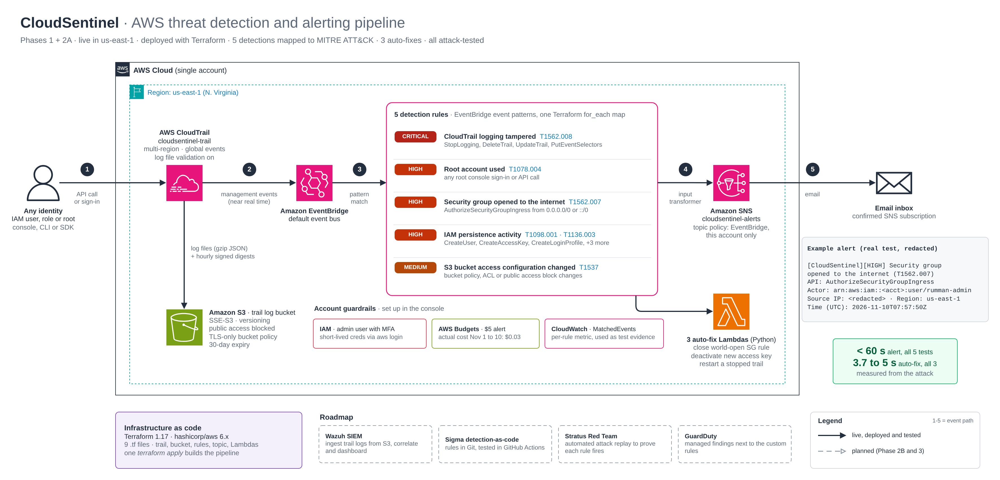
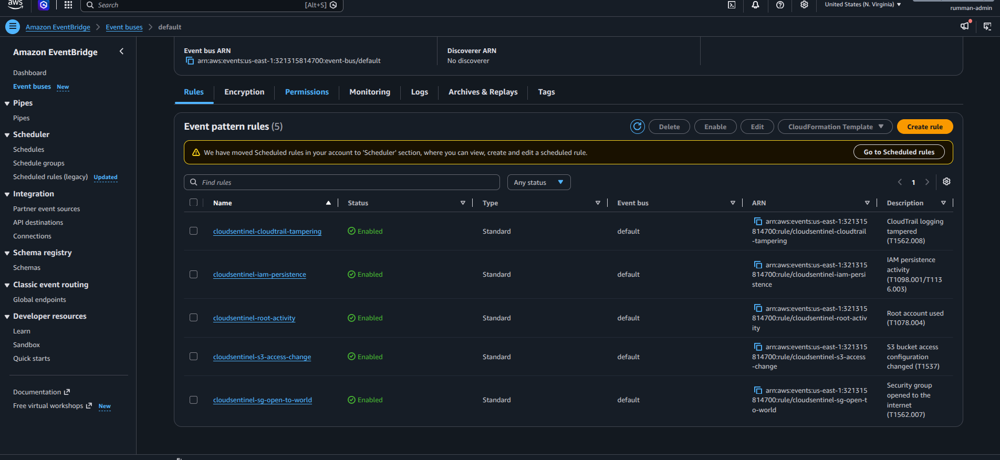
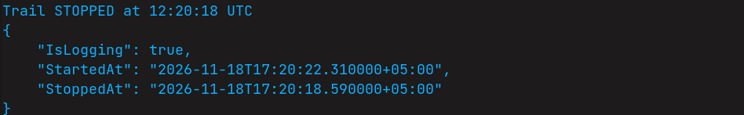
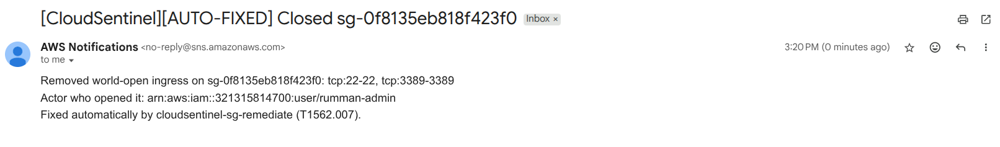
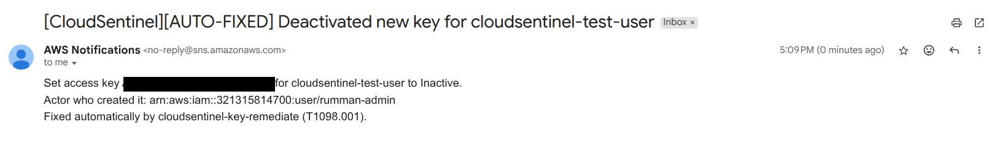
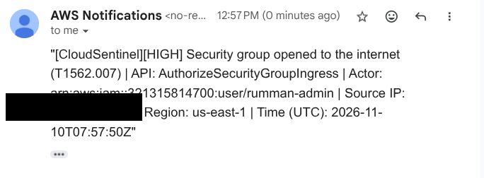
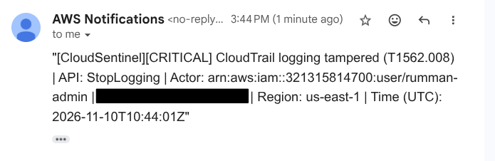
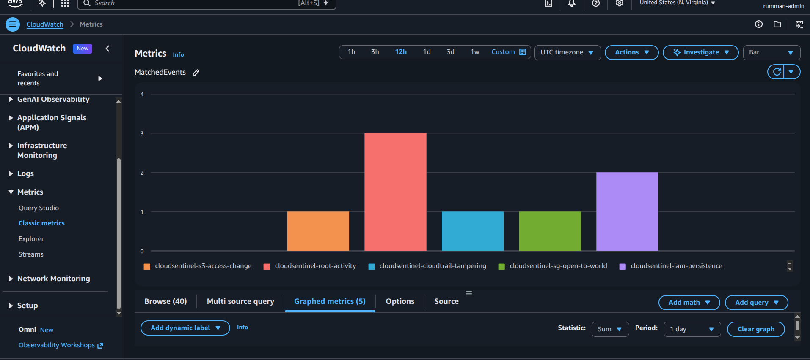

# CloudSentinel

CloudSentinel watches my AWS account for five risky actions, emails me when one happens, and fixes three of them on its own. Every alert in my tests arrived in under a minute. The three auto-fixes finished 3.7 to 5 seconds after the attack. It all deploys with Terraform.

I built it because I wanted to see if I could catch the things attackers actually do in an AWS account, without spending more than a few dollars a month.

Each detection maps to a MITRE ATT&CK technique. I tested every one by doing the risky thing myself, then cleaning up.

**Where it stands:** detection, alerting and auto-remediation work. A SIEM and detection rules as code are next. Neither exists yet.

## How it works

CloudTrail records every API call in every region. It keeps a copy in an S3 bucket and sends the events to EventBridge. Five rules there watch for the risky ones. A match goes to an SNS topic that emails me, and for three of the rules it also runs a Lambda that undoes the change.

    API call (any region)
          |
    CloudTrail (1 multi-region trail)
          |------> S3 bucket (versioned, encrypted, log file validation on)
          |
    EventBridge (5 rules, us-east-1)
          |------> SNS topic ------> email alert
          |
          |------> Lambda (3 of the 5 rules) ------> fix + "AUTO-FIXED" email

Each alert is one line, so it's quick to read:

`[CloudSentinel][HIGH] Security group opened to the internet (T1562.007) | API: AuthorizeSecurityGroupIngress | Actor: arn:aws:iam::<account>:user/rumman-admin | Source IP: <hidden> | Region: us-east-1 | Time (UTC): 2026-11-10T07:57:50Z`

## The five detections

| Rule | Fires on | ATT&CK | Severity | Auto-fix |
| --- | --- | --- | --- | --- |
| cloudtrail-tampering | StopLogging, DeleteTrail, UpdateTrail, PutEventSelectors | T1562.008 Disable or Modify Cloud Logs | CRITICAL | Restarts logging after StopLogging |
| root-activity | Any root sign-in or API call | T1078.004 Valid Accounts: Cloud Accounts | HIGH | No, alert only |
| sg-open-to-world | A security group rule opened to 0.0.0.0/0 or ::/0 | T1562.007 Disable or Modify Cloud Firewall | HIGH | Removes the open rule (port 443 is left alone) |
| iam-persistence | CreateUser, CreateAccessKey, CreateLoginProfile, AttachUserPolicy, PutUserPolicy, AddUserToGroup | T1098.001 Additional Cloud Credentials, T1136.003 Create Cloud Account | HIGH | Deactivates a new access key |
| s3-access-change | Bucket policy, ACL, or public access block changes | T1537 Transfer Data to Cloud Account (a precursor signal, not exfiltration itself) | MEDIUM | No, alert only |

## Auto-remediation

Three small Python Lambdas run on the same EventBridge rules that send the alerts. Each one reads the CloudTrail event, checks whether it should act, makes one change, and emails me what it did.

| Lambda | What it does | Can only |
| --- | --- | --- |
| cloudsentinel-sg-remediate | Removes inbound rules open to 0.0.0.0/0 or ::/0 on the group that changed. Port 443 is skipped, since a public website needs it. | Describe security groups, revoke ingress |
| cloudsentinel-key-remediate | Sets a newly created access key to Inactive. It isn't deleted, so it can be switched back on. | Update access key status |
| cloudsentinel-trail-remediate | Calls StartLogging when someone stops the CloudSentinel trail. | Start logging and read status on this one trail |

Each Lambda has its own IAM role with only those permissions, plus publishing to the alert topic and writing its own logs.

Safety checks I built in:

- **Dry-run mode.** With `remediation_dry_run = true` (the default), the Lambdas only email what they would change. I deployed the first one in dry-run, checked that it changed nothing, then switched it on.
- **Allowlists.** A security group tagged `cloudsentinel:allow-public=true` is skipped. Users listed in `remediation_allowed_users` keep their new keys.
- **Root and S3 stay alert-only.** Root activity needs a human to judge it. Changing a bucket's access back automatically could break something that was changed on purpose.
- **DeleteTrail stays alert-only.** A deleted trail can't simply be switched back on. Recreating it is a job for Terraform, not a Lambda.

### What I tested

| Auto-fix | What I did | Attack (UTC) | Fixed (UTC) | Time to fix |
| --- | --- | --- | --- | --- |
| Security group | Opened port 8080 to 0.0.0.0/0 on a group that already had 22 and 443 open | 10:38:31 | 10:38:36 | about 5 s |
| Access key | Created a second access key for a throwaway user | 12:09:18 | 12:09:22 | about 4 s |
| CloudTrail | Stopped logging on the trail | 12:20:18.59 | 12:20:22.31 | 3.7 s |

The CloudTrail times come from AWS's own StopLoggingTime and StartLoggingTime, so that one is exact. The other two attack times come from the alert emails, which round to the second.

In the security group test the Lambda closed 22 and 8080 and left 443 open, which is what it should do.

## What I tested in Phase 1

I ran each action with the AWS CLI, waited for the email, and then deleted what I'd made. For the IAM test, that was a throwaway user and access key.

| Detection | What I ran | Event time (UTC) | Alert arrived |
| --- | --- | --- | --- |
| sg-open-to-world | Opened port 22 to 0.0.0.0/0 on a new security group | 07:57:50 | under 10 s |
| iam-persistence | Created an IAM user, then an access key for it | 08:03:23 and 08:03:25 | under 37 s and under 35 s |
| cloudtrail-tampering | Stopped logging on the trail, then restarted it | 10:44:01 | under 59 s |
| s3-access-change | Removed the public access block from a new bucket | 10:47:51 | under 9 s |
| root-activity | Signed in to the console as root | 07:47:35 | under 25 s |

Gmail only shows the received time to the minute, so these are upper bounds. I compared that minute with the event time CloudTrail recorded. Every alert landed inside one minute.

More screenshots are in `docs/evidence/`.

## Things that tripped me up

- My admin IAM user couldn't open the Billing console, even with AdministratorAccess. Only the root user can turn on IAM access to billing. I switched it on once as root, then went back to the admin user.
- A leftover KMS key from an older lab was $0.68 of my $0.71 bill for October as of the 22nd. A disabled key still costs $1 a month, so I scheduled it for deletion. It's gone now.
- I indented one line of Python with a Tab while the rest used spaces. The alert email came through, so I thought everything worked, but port 22 was still open. Only the CloudWatch log told me why: `inconsistent use of tabs and spaces`. One invisible character broke the whole fix. I converted the tabs and redeployed.
- A paste went wrong and a Lambda file ended up as one stray word. `py_compile` passed because a single name is valid Python, but the function failed as soon as it ran. Compiling isn't the same as testing.
- Failed Lambda runs get retried automatically. After I fixed the tab error I got two AUTO-FIXED emails instead of one, one for port 22 and one for 8080. My best guess is that a retry of the failed run closed 22 before the new event closed 8080.

## Design choices

- One multi-region trail covers every region, and the first copy of management events is free, so I didn't need a second trail.
- I turned on log file validation so I can tell if someone edits the logs later.
- The bucket uses SSE-S3 instead of a KMS key. I get encryption at rest without paying $1 a month for a key.
- Versioning is on. Old versions stay for 7 days, and logs expire after 30.
- The bucket policy lets only this trail write, using an aws:SourceArn check, and it blocks plain HTTP.
- All five detections live in one Terraform map, and the rules and targets are built from it. Adding a sixth means adding one block.
- An EventBridge input transformer turns the raw event into the one-line alert, so I don't need a Lambda for that.
- The fix Lambdas are extra targets on the existing rules, so the alert still goes out even if a fix fails.
- Lambda logs are kept for 7 days to keep the cost near zero.
- I log in with `aws login`, so there are no long-lived access keys on my laptop.
- Everything runs in us-east-1, because IAM and root sign-in events only reach EventBridge there.

## What it doesn't do yet

- The rules only run in us-east-1, so EC2 and S3 events from other regions slip through.
- If a fix Lambda fails, nothing tells me. The alert still arrives, but I'd only spot the failure in the logs. An alarm on Lambda errors would fix that.
- The security group fix removes every world-open rule on that group except 443, not just the one that was added.
- The key fix only deactivates the new key. It doesn't remove the user or any policies the attacker attached.
- Someone with admin rights could delete the EventBridge rules, the Lambdas or the SNS topic, and nothing would tell me.
- CloudTrail to EventBridge delivery is best-effort, so I can't promise exact timing.
- An admin can still delete log versions. A production setup would add S3 Object Lock and a separate log account.
- I expect the s3-access-change and root-activity rules to be noisy on normal admin work. I haven't tuned them.
- Alerts only go to email.

## Cost

From November 1 to 10 the bill was $0.03. All of it was S3 log storage, and CloudTrail was $0.00. The Lambdas run a few times a month, which is well inside Lambda's free allowance.

## Deploy

You need Terraform 1.10 or newer, AWS CLI 2.32 or newer, and an AWS account.

    cd terraform
    cp terraform.tfvars.example terraform.tfvars
    # put your email address in terraform.tfvars
    terraform init
    terraform apply

Then click the confirmation link in the SNS email. Alerts don't arrive until you do.

The fix Lambdas start in dry-run mode. To let them make changes, add `remediation_dry_run = false` to `terraform.tfvars` and run `terraform apply` again.

To remove everything, run `terraform destroy`. It also deletes the log bucket and the logs in it.

## What's next

- Wazuh reading the CloudTrail logs, so alerts land in a SIEM.
- An alarm when a fix Lambda fails.
- Detection rules written in Sigma and tested in GitHub Actions.
- Attack testing with Stratus Red Team.
