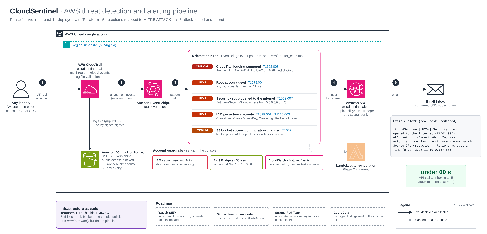
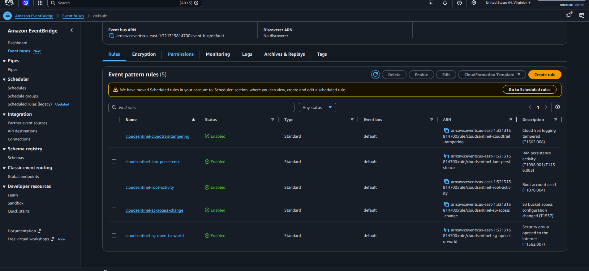
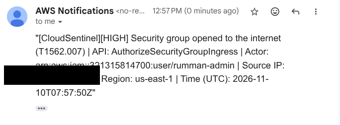
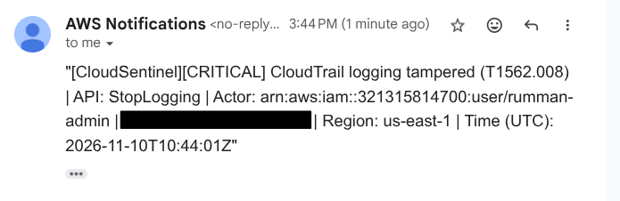
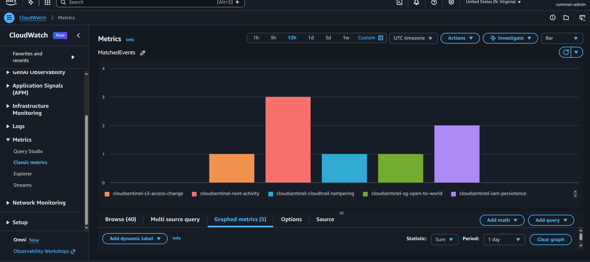

# CloudSentinel

CloudSentinel watches my AWS account for five risky actions and emails me when one happens. Every alert in my tests arrived in under a minute. It all deploys with Terraform.

Each detection maps to a MITRE ATT&CK technique. I tested every one by doing the risky thing myself, then cleaning up.

**Where it stands:** detection and alerting work. Auto-fixing, a SIEM, and detection rules as code are next. None of those exist yet.

## How it works

CloudTrail records every API call in every region. It keeps a copy in an S3 bucket and sends the events to EventBridge. Five rules there watch for the risky ones, and a match goes to an SNS topic that emails me.

    API call (any region)
          |
    CloudTrail (1 multi-region trail)
          |------> S3 bucket (versioned, encrypted, log file validation on)
          |
    EventBridge (5 rules, us-east-1)
          |
    SNS topic ------> email alert

Each alert is one line, so it's quick to read:

`[CloudSentinel][HIGH] Security group opened to the internet (T1562.007) | API: AuthorizeSecurityGroupIngress | Actor: arn:aws:iam::<account>:user/rumman-admin | Source IP: <hidden> | Region: us-east-1 | Time (UTC): 2026-11-10T07:57:50Z`

## The five detections

| Rule | Fires on | ATT&CK | Severity |
| --- | --- | --- | --- |
| cloudtrail-tampering | StopLogging, DeleteTrail, UpdateTrail, PutEventSelectors | T1562.008 Disable or Modify Cloud Logs | CRITICAL |
| root-activity | Any root sign-in or API call | T1078.004 Valid Accounts: Cloud Accounts | HIGH |
| sg-open-to-world | A security group rule opened to 0.0.0.0/0 or ::/0 | T1562.007 Disable or Modify Cloud Firewall | HIGH |
| iam-persistence | CreateUser, CreateAccessKey, CreateLoginProfile, AttachUserPolicy, PutUserPolicy, AddUserToGroup | T1098.001 Additional Cloud Credentials, T1136.003 Create Cloud Account | HIGH |
| s3-access-change | Bucket policy, ACL, or public access block changes | T1537 Transfer Data to Cloud Account (a precursor signal, not exfiltration itself) | MEDIUM |

## What I tested

I ran each action with the AWS CLI, waited for the email, and then deleted what I'd made. For the IAM test, that was a throwaway user and access key.

| Detection | What I ran | Event time (UTC) | Alert arrived |
| --- | --- | --- | --- |
| sg-open-to-world | Opened port 22 to 0.0.0.0/0 on a new security group | 07:57:50 | under 10 s |
| iam-persistence | Created an IAM user, then an access key for it | 08:03:23 and 08:03:25 | under 37 s and under 35 s |
| cloudtrail-tampering | Stopped logging on the trail, then restarted it | 10:44:01 | under 59 s |
| s3-access-change | Removed the public access block from a new bucket | 10:47:51 | under 9 s |
| root-activity | Signed in to the console as root | 07:47:35 | under 25 s |

Gmail only shows the received time to the minute, so these are upper bounds. I compared that minute with the event time CloudTrail recorded. Every alert landed inside one minute.

More screenshots are in `docs/evidence/`.

## Things that tripped me up

- My admin IAM user couldn't open the Billing console, even with AdministratorAccess. Only the root user can turn on IAM access to billing. I switched it on once as root, then went back to the admin user.
- A leftover KMS key from an older lab was $0.68 of my $0.71 bill for October as of the 22nd. A disabled key still costs $1 a month, so I scheduled it for deletion. It's gone now.

## Design choices

- One multi-region trail covers every region, and the first copy of management events is free, so I didn't need a second trail.
- I turned on log file validation so I can tell if someone edits the logs later.
- The bucket uses SSE-S3 instead of a KMS key. I get encryption at rest without paying $1 a month for a key.
- Versioning is on. Old versions stay for 7 days, and logs expire after 30.
- The bucket policy lets only this trail write, using an aws:SourceArn check, and it blocks plain HTTP.
- All five detections live in one Terraform map, and the rules and targets are built from it. Adding a sixth means adding one block.
- An EventBridge input transformer turns the raw event into the one-line alert, so I don't need a Lambda for that.
- I log in with `aws login`, so there are no long-lived access keys on my laptop.
- Everything runs in us-east-1, because IAM and root sign-in events only reach EventBridge there.

## What it doesn't do yet

- The rules only run in us-east-1, so EC2 and S3 events from other regions slip through.
- It alerts, but it doesn't fix anything.
- Someone with admin rights could delete the EventBridge rules or the SNS topic, and nothing would tell me.
- CloudTrail to EventBridge delivery is best-effort, so I can't promise exact timing.
- An admin can still delete log versions. A production setup would add S3 Object Lock and a separate log account.
- I expect the s3-access-change and root-activity rules to be noisy on normal admin work. I haven't tuned them.
- Alerts only go to email.

## Cost

From November 1 to 10 the bill was $0.03. All of it was S3 log storage, and CloudTrail was $0.00.

## Deploy

You need Terraform 1.10 or newer, AWS CLI 2.32 or newer, and an AWS account.

    cd terraform
    cp terraform.tfvars.example terraform.tfvars
    # put your email address in terraform.tfvars
    terraform init
    terraform apply

Then click the confirmation link in the SNS email. Alerts don't arrive until you do.

To remove everything, run `terraform destroy`. It also deletes the log bucket and the logs in it.

## What's next

- Lambda functions that fix things on their own, like removing an open security group rule or deactivating a new access key.
- Wazuh reading the CloudTrail logs, so alerts land in a SIEM.
- Detection rules written in Sigma and tested in GitHub Actions.
- Attack testing with Stratus Red Team.

